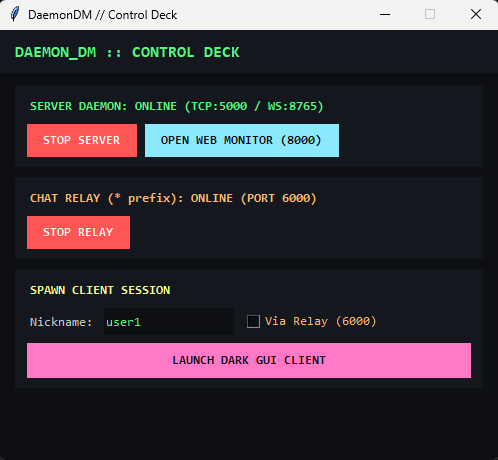
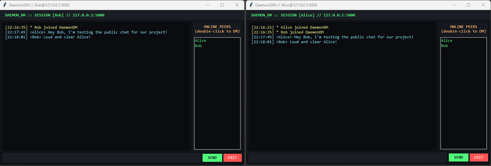

# DaemonDM
DaemonDM is a multi-user chat system.
# DaemonDM - Multi-User TCP Chat & Live Monitor

**Network Programming - Project 02**  
**App Name:** DaemonDM (Daemon Direct Messenger)

For Project 02, I built **DaemonDM**, a multi-user TCP chat system in Python. Instead of starting from scratch, I extended the socket patterns we covered in class (`03a-SimpleChatServer.py`, `05a-ws-http-server.py`, `06a-ws-poll.py`, and `06-proxy-Proxy.py`) and split the project into modular files so it is easier to read and test.

It supports public chat, private direct messages (DMs), automatic nickname collision handling, a per-user spam rate limiter, an optional TCP relay that adds the `*` prefix, and a live browser monitor (`chatd-watch`) powered by WebSockets. I also built a dark-themed Tkinter GUI and a visual launcher (`main.py`) so I wouldn't have to open 6 different terminal windows every time I tested it.

---

## 1. Setup & Dependencies

All of the core networking (`socket`, `struct`, `threading`, `http.server`, `socketserver`, `asyncio`) and the GUI (`tkinter`) use Python's built-in standard library. 

Only two external packages are used (`websockets` for the live browser monitor and `colorama` so the terminal client has readable colors). You can install both from `requirements.txt`:

    pip install -r requirements.txt

**Packages in `requirements.txt`:**
- `websockets>=12.0`
- `colorama>=0.4.6`

---

## 2. How the Code is Organized (File Breakdown)

I split the code into 7 files so the server, monitor, client, GUI, and relay aren't all crammed into one giant script:

- **`chat_server.py` (Core TCP Server):**
  This is the main server. It starts two TCP listeners using `tcp_listener()`: one on port `5000` for normal direct clients (`is_relay=False`) and one on port `5001` for connections coming from the relay (`is_relay=True`). Every time a client connects, `sock.accept()` hands the socket off to a daemon thread running `handle_chat_client()`. It stores active users in the `clientmap` dictionary, checks for spam in `check_rate_limit()`, writes logs to `daemondm.log` inside `log_event()`, and forwards live stats to `monitor_server.py`.

- **`monitor_server.py` & `monitor.html` (WebSocket + HTTP Monitor):**
  Based directly on `05a-ws-http-server.py` and `06a-ws-poll.py` from class. `start_http_server()` runs in a background thread on port `8000` using `SimpleHTTPRequestHandler` to serve `monitor.html`. Meanwhile, `start_ws_server()` runs on the main `asyncio` loop on port `8765`. Whenever `chat_server.py` logs an event, it calls `monitor_server.push_event()`, which uses `asyncio.run_coroutine_threadsafe()` to push a JSON update to any open browser tabs without blocking the TCP chat threads.

- **`chat_client.py` (TCP Client - Console & GUI Entry Point):**
  Adapted from `03b-SimpleChatClient.py`. When `ChatClient` initializes, it connects to the TCP server, sends `NAME: <nickname>`, and waits for `CLIENT: <assigned_name>` (or an `ERROR:` response). In console mode (`run_console()`), it spawns a background `input_thread()` to read `sys.stdin.readline()` while the main loop listens for incoming messages with `receive()`, so incoming messages never get stuck while you are typing.

- **`client_gui.py` (Dark-Mode Tkinter UI):**
  If you pass `--gui` to `chat_client.py`, it loads `run_gui()` from this file. It builds a dark terminal-style window with a scrollable chat log on the left and an `ONLINE PEERS` listbox on the right. Since Tkinter isn't thread-safe, the background receive thread (`gui_recv_loop()`) uses `root.after(0, ...)` to safely update the UI when messages or `USERS:` lists arrive.

- **`chat_relay.py` (Optional `*` Prefix Relay Proxy):**
  Built on `06-proxy-Proxy.py`. It listens on port `6000`. When a client connects, `handle_client()` reads the initial registration frame using `receive()`. If the client tried to pick a name starting with `*`, the relay rejects it immediately. Otherwise, it prepends `*` to the nickname, opens an upstream socket to the server's relay port (`5001`), sends the modified `NAME: *<nick>` packet, and starts two threads running `forward_stream()` to pipe raw TCP bytes in both directions until either side disconnects.

- **`main.py` (Control Deck Launcher):**
  A small Tkinter control panel that uses `subprocess.Popen` to start/stop `chat_server.py`, `chat_relay.py`, open `http://127.0.0.1:8000` in the default browser, and spawn multiple GUI clients with one click.

---

## 3. How to Run It

### Option 1: Using the Control Deck GUI (`main.py`)
The easiest way to test everything is running the launcher:

    python main.py

1. Click **START SERVER** (starts TCP ports `5000`/`5001`, HTTP `8000`, and WS `8765`).
2. Click **OPEN WEB MONITOR (8000)** to open the `chatd-watch` live log page in your browser.
3. Type a nickname, optionally check **Via Relay (6000)**, and click **LAUNCH DARK GUI CLIENT** as many times as you want to open multiple client windows.

### Option 2: Running Each Script Manually in the Terminal
Every script also works on its own with command-line flags (all addresses and ports have defaults so flags are optional):

**1. Start the server:**

    python chat_server.py --host 127.0.0.1 --port 5000 --relay-port 5001 --http-port 8000 --ws-port 8765

**2. Open the live monitor in your browser:**

    http://127.0.0.1:8000

**3. Start the optional relay proxy:**

    python chat_relay.py --host 127.0.0.1 --port 6000 --server-host 127.0.0.1 --server-port 5001

**4. Start clients (GUI or Console):**

    # Launch GUI client connected directly to the server
    python chat_client.py --host 127.0.0.1 --port 5000 --name alice --gui

    # Launch Console client connected directly to the server
    python chat_client.py --host 127.0.0.1 --port 5000 --name bob

    # Launch client through the relay (will be assigned *charlie)
    python chat_client.py --host 127.0.0.1 --port 6000 --name charlie --gui

---

## 4. Client Commands & Sending Private Messages (DMs)

- **Public Message:** Just type your message and hit `Enter`.
- **Private Message in GUI:** Double-click any user in the `ONLINE PEERS` list on the right—it automatically fills `/msg <username> ` into the input box for you.
- **Private Message in Console:**
  - By name: `/msg <nickname> <message>`
  - By user list number: Type `/users` to see everyone's number, then type `/to <number> <message>`
- **Leaving the Chat:** Type `exit` or `/exit`, or click the red `EXIT` button in the GUI.

---

## 5. Design Notes & Protocol Details

### Message Framing & Handling TCP Fragmentation
In `03a-SimpleChatServer.py`, we saw how to prefix messages with their byte length using `socket.htonl()` and `struct.pack()`. I kept that exact approach in `send()` and `receive()`, except I replaced `pickle` with UTF-8 strings and improved `receive()` so it handles fragmented TCP reads properly:
- **Header:** 4-byte unsigned integer in network byte order (`!I`).
- **Payload:** UTF-8 string up to `BUF_SIZE = 4096` bytes.
- **Fragmentation / Multiple Reads:** Because TCP is a byte stream, a single `recv()` call might return only half a packet or two packets stuck together. My `receive()` function first loops until it has read all 4 bytes of the length header (`while len(size_data) < size_len:`), unpacks the exact payload length `size`, and then loops again (`while len(buf) < size:`) reading only the remaining bytes needed for that specific message.

### Application Protocol Format
Instead of overcomplicating packets, messages use simple text prefixes:
- `NAME: <req_name>` — Sent by the client right after connecting.
- `CLIENT: <assigned_name>` — Sent back by the server once the nickname is registered.
- `PUBLIC: <text>` — Sent by a client for public chat; broadcast by the server as `PUBLIC: [HH:MM:SS] <sender> <text>` to every connected user (including the sender).
- `PRIVATE: <target>|<text>` — Sent by a client for DMs. The server sends `PRIVATE: [HH:MM:SS] [DM from <sender>] <text>` only to `<target>` and sends a confirmation copy `[DM to <target>]` back to `<sender>`.
- `USERS: <user1,user2,...>` — Sent to all clients whenever someone joins or leaves so user lists stay in sync.
- `SYS: <notice>` and `ERROR: <reason>` — Server notifications and error replies.
- **No Spoofing:** Clients never send their own nickname inside `PUBLIC:` or `PRIVATE:` packets. The server always attaches `cname` (the nickname registered to that specific socket thread), so a client cannot impersonate someone else.

### Nickname Uniqueness & The `*` Relay Rule
- **Unique Suffixes:** Inside `handle_chat_client()`, checking `clientmap` and inserting the new user happens inside `with state_lock:`. If `user1` is already online, the server loops (`user11`, `user12`, etc.) until it finds a free name and returns it in `CLIENT: `. This also works for relayed users (e.g., `*dave` -> `*dave1`).
- **Blocking Direct `*` Names:** If a client connects to the direct chat port (`5000`, where `is_relay=False`) and asks for `*hacker`, the server rejects it with `ERROR: Prefix '*' is reserved for relay clients.` and closes the socket. Only connections arriving on the server's relay port (`5001`, where `is_relay=True`) are allowed to register with a single leading `*`.

### Concurrency & Thread Safety
- The server uses one daemon thread per client connection.
- A shared `state_lock = threading.Lock()` protects `clientmap`, `msg_counter`, and writing to `daemondm.log`.
- Each client also gets its own socket lock (`c_lock = threading.Lock()`). When multiple threads broadcast messages at the same time, `send(sock, msg, lock)` locks that specific client's socket before calling `sendall()`, so two outbound frames never get mixed together on the wire.

### Logging, Live Monitoring & Message Counter
- **Local Log File:** All events (`BOOT`, `JOIN`, `LEAVE`, `PUBLIC`, `PRIVATE`, `REJECT`, `RATELIMIT`, `ERROR`) are appended to `daemondm.log` in the project folder.
- **Separate Monitoring Ports:** The HTTP server runs on `8000` and the WebSocket stream runs on `8765`, completely separate from the chat ports (`5000`/`5001`). Opening or closing the monitor page does not affect chat users, and monitor viewers do not show up in `clientmap`.
- **Counter Logic:** `msg_counter` increases by `1` whenever the server processes and forwards a valid `PUBLIC` message (even if it goes to 5 users) or a valid `PRIVATE` message to an online user. Rejected messages (like offline DMs or rate-limited spam) do not increase the counter.

### Rate-Limit Policy
- **Rule:** Maximum **5 messages per 5.0 seconds** per user (`RATE_LIMIT_COUNT = 5`, `RATE_LIMIT_WINDOW = 5.0`).
- **Behavior:** Inside `check_rate_limit(cname)`, the server keeps a list of recent message timestamps for each user. If a user sends a 6th message within 5 seconds, their `muted` timestamp is set to `now + 10.0` seconds (`MUTE_SECONDS = 10.0`). While muted, their messages are dropped, the server logs a `RATELIMIT` warning, and the user gets an error message telling them how many seconds are left on their mute.

---

## 6. Functional Tests (T01 - T07)

### T01 - Public Chat
Connected two Python clients (`user1` and `user2`). Sent public messages back and forth and verified that both clients see the server timestamps, assigned nicknames, and the synchronized online user list.

### T02 - Private Chat (Direct Messages)
Connected three clients. Sent a private message between two of them and verified that the third client did not receive it. Also tested `/msg` to a nickname that isn't online to verify the server returns `ERROR: User '...' is not online.`

### T03 - Nicknames & Reserved `*` Prefix
